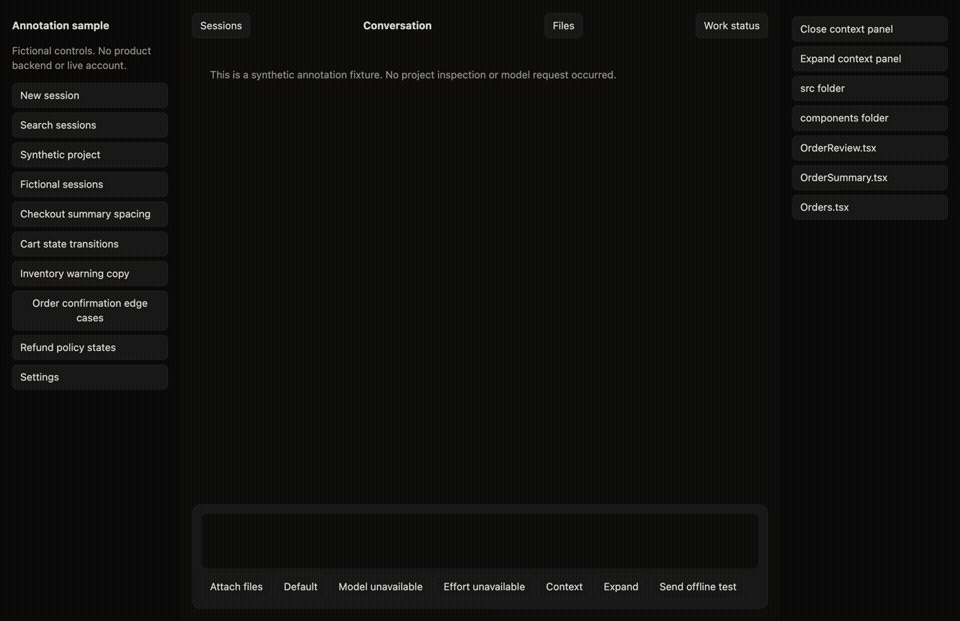
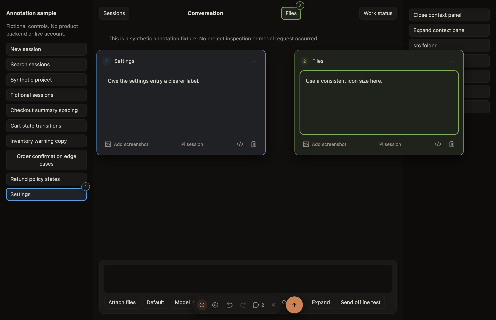
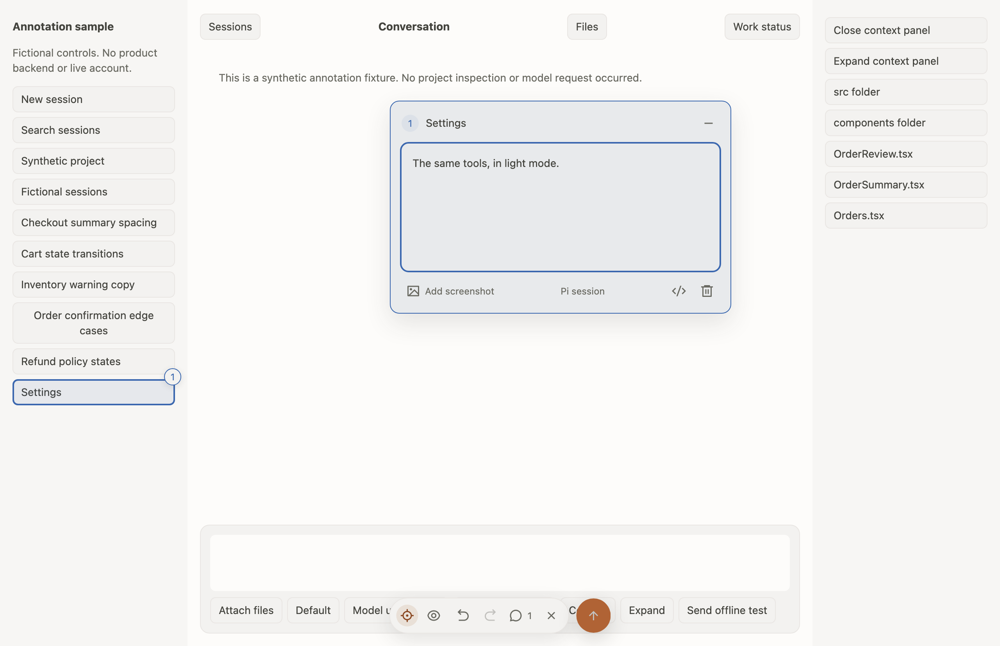
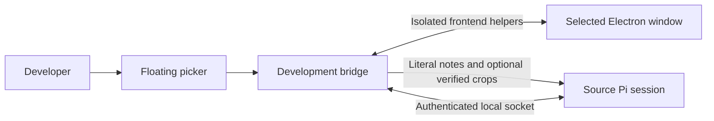

<p align="center"></p>

# Pi Annotate Electron

**Point. Annotate. Send to Pi.**

Give your Pi coding session precise feedback on an Electron development UI. Select elements, write notes, and send them with element context and optional crops—all from a small floating toolbar.



[Watch the short video](docs/media/demo.mp4) · [Architecture](docs/ARCHITECTURE.md) · [Connection protocol](docs/ELECTRON_DEVELOPMENT_UI_PROTOCOL.md) · [Report an issue](https://github.com/leoscricca/pi-annotate-electron/issues)

The demo uses the included fictional sample in a hidden macOS Electron window. It makes no live account or model calls.

## What you get

- **One selection button.** Point at an element and leave a note without activating its app action.
- **Distinct annotation colors.** Matching outlines, markers and note cards make selections easy to follow. Colors stay stable through undo and redo within a request.
- **A movable icon dock.** Drag its edges or gaps; hide annotations, undo, redo, or send with one click.
- **A focused editor.** Write a comment, minimize it, delete it, or open element details. The details toggle stays in place.
- **Optional screenshots.** No image by default. Each note has its own Add screenshot / Element crop control.
- **Light and dark themes.** Scoped OpenChamber tokens follow the app's explicit `data-theme` or the system color preference.
- **Bounded frontend tools.** Pi can inspect snapshots, request screenshots, interact with current element references, and read frontend diagnostics.

| Dark | Light |
| --- | --- |
|  |  |

## Requirements and support

Current support is **macOS development apps** with an existing main entry, a fixed local HTML renderer, Electron's default session, and the compatible external bootstrap. Use Node **24.22 or later** and an installed [Pi coding agent](https://pi.dev/).

The launcher runs your development entry with the package's pinned Electron runtime. Build your target app first. Native modules must support that runtime. This release does not establish support for packaged apps, Windows, arbitrary running Electron processes, remote renderer URLs, or every Electron framework.

The app keeps its own authentication, product features, and agent sessions. Pi remains responsible for your coding session and model provider.

## Install

Install the tagged GitHub package in Pi:

```sh
pi install git:github.com/leoscricca/pi-annotate-electron@v0.1.0
```

Start a fresh Pi session after installation. The npm package and Pi catalog listing are pending the first npm publication; Git installation is available independently. See the [release guide](docs/RELEASING.md).

For a source checkout, including the external app launcher:

```sh
git clone https://github.com/leoscricca/pi-annotate-electron.git
cd pi-annotate-electron
git checkout v0.1.0
npm ci
```

If Electron's dependency install script was blocked by your npm policy, run `node node_modules/electron/install.js` in this checkout to download the pinned runtime.

To load only this checkout in a single Pi process, use `pi -e ./extensions/annotate-electron.ts` instead of also installing the package. Avoid loading two copies in one session.

## Start a development app with explicit opt-in

From the extension checkout, launch your already-built app in another terminal:

```sh
npm run start:app -- \
  --app /absolute/path/to/your-app \
  --entry out/main/index.js \
  --renderer out/renderer/index.html
```

Replace these example paths with your app's actual files. Entry and renderer must exist inside the selected root, which must contain `package.json`. Application bundles and ASAR archives are refused. An optional `--profile /absolute/path/to/profile` chooses an explicit profile; the launcher does not delete it. Use an approved development profile.

To try the fictional sample, run `npm run build`, then use the same command with this checkout as `--app`. Its entry and renderer match the example.

The launcher installs the bridge before importing the app entry. Ordinary app startup advertises no bridge. An already-open app needs a manual restart through this launcher; connecting does not launch, restart, or reload it.

## Connect and annotate

In the Pi session that should receive your feedback:

```text
/annotate-electron connect
```

Choose the intended window if Pi offers multiple compatible targets. The picker opens after a verified connection. Select an element, write your feedback, and press the floating send arrow. The eye toggles visibility, the dash minimizes a note, and the bin deletes it. Numbered markers reopen notes. The code icon reveals element context; details depend on the route's privacy rules.

| Command | Action |
| --- | --- |
| `/annotate-electron connect` | Connect, or reopen the idle picker on the current connection |
| `/annotate-electron none` | Start a new picker with images off by default |
| `/annotate-electron crop` | Start with per-note element crops enabled |
| `/annotate-electron cancel` | Cancel the picker and keep the UI connection |
| `/annotate-electron status` | Inspect connection or cleanup state |
| `/annotate-electron disconnect` | Detach without closing the app |
| `/annotate-electron close` | Detach an attached app; normally close an owned sample |
| `/annotate-electron open` | Request confirmation to open a separate fictional sample |

While selection is active, agent input and product operations are blocked. Native HTML app modals prevent picker activation or cancel an active picker. After navigation, reload, or transport loss, reconnect explicitly. Save app work before any manual restart.

## Architecture and protocols



Two routes have different authority. **Attached development** connects to one explicitly bootstrapped window and detaches on close. **Owned synthetic** launches this package's fictional sample, enforces its frozen content catalog, and may close its own child. Neither route creates a second application agent.

| Interface | Support |
| --- | --- |
| Version 1 JSON messages over a private Unix-domain socket | Supported; mutually authenticated, same-user local discovery |
| Explicit Electron bootstrap + fixed local HTML renderer | Supported on eligible macOS development apps |
| `annotate_electron` Pi tool | Annotation lifecycle, with a closed schema |
| `electron_ui` Pi tool | Bounded snapshots, screenshots, input, and diagnostics |
| Public CDP, WebSocket, HTTP app endpoints, MCP attachment | Not connection interfaces in this package |
| Arbitrary JavaScript, shell, file operations, backend access | Not exposed by the tools |

The bridge uses Electron's internal debugger API and fixed isolated-world helpers. It opens no public debugger port. Every operation is bound to the source Pi session, app instance, window, connection, and document generation. Input references require a current snapshot revision and the same live node. An input timeout requires inspecting state before another input; operations are never replayed automatically.

Read the [architecture guide](docs/ARCHITECTURE.md) for the source map and lifecycle, or the [wire specification](docs/ELECTRON_DEVELOPMENT_UI_PROTOCOL.md) for authentication, schemas, limits, and refusal outcomes.

## Privacy and cleanup

Use only an approved development app and profile. **Attached UI content is trusted and unmasked:** UI text, URLs, frontend errors, and requested images can reach Pi's configured model. Local transport does not imply local model inference. Comments and element facts remain untrusted review input and do not grant permission to edit source or operate processes.

No-image and camera-off notes make zero screenshot calls. Network diagnostics retain no headers, cookies, or request or response bodies. Registry and image directories use `0700`; sockets, records, and images use `0600`. Images are checked against actual PNG bytes, dimensions, digest, ownership, and file identity before delivery.

Disconnect removes owned helpers and listeners without closing, reloading, or restarting the attached app. It preserves retained images. Image removal requires a separate owner request. Unknown cleanup stays blocked with its evidence; an expired timeout or dead socket is not proof of cleanup.

The fictional route has stricter reviewed-content and capture guards. It cannot learn its safe catalog from a real app. [Attached guide](docs/DEVELOPMENT_UI_CONNECTION.md) · [Synthetic guide](docs/ELECTRON_ANNOTATION_FEEDBACK.md)

## Develop and verify

```sh
npm ci
PLAYWRIGHT_BROWSERS_PATH=0 ./node_modules/.bin/playwright install chromium --only-shell
npm run build
npm run typecheck
npm run check:package
npm test
```

Native terminal regressions also need Python 3.9 or later, using its standard library. Tests use headless Chromium, hidden macOS Electron windows, fictional data, private temporary profiles, and offline Pi sessions. Host SDKs remain peers; pinned local development copies support isolated tests. Those checks do not establish foreground focus, Windows, packaged-app, or live-provider acceptance.

To regenerate screenshots and the demo with the actual hidden sample, install `ffmpeg` and the headless Chromium dependency above, then run `npm run demo`. The current Orbit Mark uses [Catppuccin Mocha](https://catppuccin.com/palette/): three thin Peach loops, a Blue annotation bubble, and a Mauve accent dot on a dark Base tile. Original artwork is available as [SVG](docs/media/logo.svg) and [PNG](docs/media/logo.png). The [earlier concepts](docs/media/logo-options.png) remain available for reference.

See [release checks](docs/RELEASING.md), [verification records](docs/VERIFICATION.md), and [design provenance](design/DESIGN.md). Historical documents describe their original source versions.

## License

[MIT](LICENSE), © 2026 Leonardo Scricca. The original logo is included under the same license. Pi Annotate, OpenChamber tokens, Catppuccin palette colors, and functional icon assets retain their respective licenses and attribution in [THIRD_PARTY_NOTICES.md](THIRD_PARTY_NOTICES.md).
